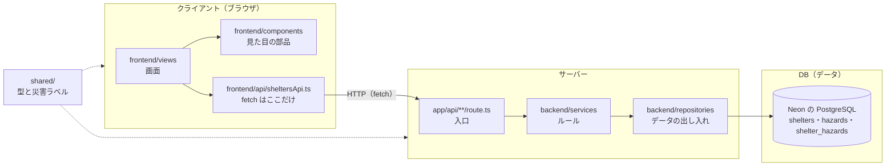
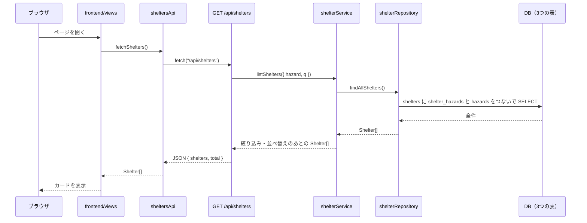

# CLAUDE.md（静岡市の指定緊急避難場所・学習用・DB版）

## このアプリは何か

静岡市の指定緊急避難場所（402か所）を地図と一覧で見せる、学習用の小さなアプリです。Next.js 16.4.6 で作っています。
データは **国土地理院の「指定緊急避難場所データ」** です（静岡県のデータから静岡市の行を抜き出したもの。出典と注意は `data/README.md`）。画面には出典と「ご利用上の注意」を必ず出します（`frontend/components/DataNotice.tsx`）。消したり短くしたりしません。
データは **DB（Neon の PostgreSQL）** の3つの表から読みます。`shelters`（場所。主キーは共通ID）、`hazards`（災害の種類）、`shelter_hazards`（場所と種類をつなぐ表）です。表の作り方は `scripts/seed-db.mjs` にあります。

このアプリでいちばん大事なのは、**フロントエンドとバックエンドの役割を分けること**です。
機能を足すときも、この分け方を崩さないでください。

## 編集してよい範囲（いちばん先に守る）

**このアプリでは、基本的に UI（画面の側）だけを編集します。**

| 区分 | フォルダ・ファイル | 編集 |
|---|---|---|
| UI | `frontend/`（`views/`、`components/`、`api/sheltersApi.ts`）、ページの入口（`app/page.tsx`、`app/<名前>/page.tsx`）、見た目（`app/layout.tsx`、`app/globals.css`） | してよい |
| サーバー | `app/api/`、`backend/` | 頼まれたときだけ |
| 約束事とデータ | `shared/`、`data/`、`scripts/` | 頼まれたときだけ |
| 設定 | `package.json`（部品の追加を含む）、`eslint.config.mjs`、`next.config.ts`、`tsconfig.json` | 頼まれたときだけ |

- 頼まれた機能を、まず UI の側だけで作れないかを考えます。今の API でできることは、`GET /api/shelters`（`?hazard=` で災害の種類、`?q=` で名前・住所の絞り込み）、`GET /api/shelters/[id]`（1件）、`GET /api/hazards`（災害の種類ごとの件数）です
- UI だけでは作れないときは、作り始める前に止まります。「なぜ UI だけでは作れないか」と「どのファイルを変える必要があるか」を伝え、了解を得てから進めます
- 「頼まれたとき」とは、利用者がそのフォルダやファイルを変えてよいと、はっきり言ったときです。「機能を足して」だけでは、UI の外を変えてよい理由になりません

## 3つの層はどこにあるか

| 層 | フォルダ | 持つもの | 持たないもの |
|---|---|---|---|
| クライアント | `frontend/`、`app/page.tsx`、`app/shelters/` | 画面、見た目、fetch の呼び出し（`frontend/api`） | データの絞り込みルール、`data/` の読み込み |
| サーバー | `app/api/`、`backend/services/`、`backend/repositories/` | リクエストの読み取り、絞り込み・並べ替え・見つからない判断、データの出し入れ（repository） | 画面の文言、HTML、JSX |
| DB（データ） | Neon の PostgreSQL（`shelters`・`hazards`・`shelter_hazards` の3つの表）。`data/shizuoka-city-shelters.csv` は、DBに入れる元のデータ | データそのもの | コード、ルール |
| 共通 | `shared/` | 型（`Shelter` など）、災害のキーとラベル | 上の層のコード |

## 1回のリクエストの流れ

## 守るルール（Claude はこれに従う）

向きは **frontend → HTTP → app/api → backend/services → backend/repositories → data** の一方向です。逆向きの呼び出しは作りません。

1. `frontend/**` から `backend/**` と `data/**` を import しない。
2. `backend/**` から `frontend/**` を import しない。
3. `shared/**` は frontend、backend、data を import しない。どちらの層からも import してよい。
4. `app/api/**` が import してよいのは `backend/**` と `shared/**` だけ。
5. `app/page.tsx` と `app/shelters/**` が import してよいのは `frontend/**` と `shared/**` だけ。
6. `backend/**` のファイルは、先頭に `import "server-only";` を書く。
7. DB に問い合わせるのは `backend/repositories/shelterRepository.ts` だけ。`data/shizuoka-city-shelters.csv` を読むのは `scripts/seed-db.mjs` だけ（DBに入れるとき）。
8. APIのURLを知り、`fetch` を呼ぶのは `frontend/api/sheltersApi.ts` だけ。

守らせる仕組みは2つあります。

- ESLint の `no-restricted-imports`（`eslint.config.mjs`）。境界を破ると `npm run lint` が失敗します。
- `server-only`。backend のコードをブラウザ側が import すると、ビルドが失敗します。

## 機能を足すときの手順

各手順は、上から順に触ります。「UIの外も触る」と書いた手順は、上の「編集してよい範囲」に沿って、始める前に了解を得ます。

**(a) 災害の種類で絞り込むボタン（作り済み）**
`frontend/components/HazardFilter.tsx` にあります。件数は `GET /api/hazards` から取ります。

**(b) 検索欄（フロントだけ）**
バックエンドはもう `q` に対応しています。(a) と同じ形で、`q` を渡します。

**(c) 新しい項目を表示する（UIの外も触る）**
1. `shared/types.ts`：`Shelter` に項目を足す
2. `scripts/seed-db.mjs`：表の列と、CSV のどの列から入れるかを足す
3. `backend/repositories/shelterRepository.ts`：読み方を直す
4. `backend/services/shelterService.ts`：ルールが要るときだけ
5. `frontend/components/`：表示を足す

**(d) DB の中身を足す・直す（UIの外も触る）**
- データを足す・直すだけなら、コードは触りません。Data Editor か SQL で、`shelters` や `shelter_hazards` の行を足したり直したりします。災害の種類は `hazards` にある8つしか入りません（外部キー）
- `npm run db:seed` は3つの表を作り直すので、DB で直した値は CSV の値に戻ります
- 表の形（列や表の数）を変えるときは、先に「あとで DB にどんな問いを出したいか」を書き出してから決めます。変えたら `scripts/seed-db.mjs`、`backend/repositories/`、`shared/types.ts` を合わせて直します
- DB の接続先は、環境変数 `DATABASE_URL` から読みます。値を書いたファイル（`.env.local`）は GitHub に送りません（`.gitignore` で外してあります）

**(e) 地図（作り済み）**
`frontend/components/ShelterMap.tsx` にあります（Leaflet と OpenStreetMap）。Leaflet はブラウザの中でしか動かないので、`next/dynamic` の `ssr: false` で読み込んでいます。地図の画像（タイル）を使うときは、OpenStreetMap の表示（attribution）を消しません。

**(f) 新しいAPIを足す（UIの外も触る）**
1. `shared/types.ts`：返す形（response の型）を決める
2. `backend/repositories/`：新しいデータが要るときだけ関数を足す
3. `backend/services/`：ルールを書く
4. `app/api/<名前>/route.ts`：入口を作る（読み取り、service を呼ぶ、JSON で返す）
5. `frontend/api/sheltersApi.ts`：呼び出す関数を足す
6. `frontend/views` か `frontend/components`：画面に出す

**(g) ページを足す**
1. `app/<名前>/page.tsx`：入口を作る。中身は `frontend/views` の画面を呼ぶだけにする
2. `frontend/views/`：画面を作る（データは `sheltersApi.ts` から取る）

このアプリは `next.config.ts` で `cacheComponents` が有効です。入口で `params` を `await` するときは、その部分を `Suspense` で包みます。包まないと `npm run build` が失敗します。書き方は `app/shelters/[id]/page.tsx` を見てください。

## やってはいけないこと

- コンポーネントや view の中で直接 `fetch` する（`sheltersApi.ts` に書く）
- フロントから `data/` を読む、`backend/` を import する
- 絞り込みや並べ替えのルールをフロントに書く（`backend/services` に書く）
- バックエンドに画面の文言や HTML を入れる（返すのはデータと、エラーのメッセージだけ）
- ESLint のルールを弱める、`eslint-disable` で境界チェックを消す
- `npm run check` を通さずに終わる

## コマンド

| コマンド | 何をするか |
|---|---|
| `npm run dev` | 開発用サーバーを起動（http://localhost:3000） |
| `npm run lint` | ESLint。層の境界もここで調べる |
| `npm run check` | lint、型の準備（`next typegen`）、型チェック、ビルドをまとめて実行 |
| `npm run db:seed` | `data/shizuoka-city-shelters.csv` から、DB の3つの表を作り直して入れる。DB で直した値は CSV の値に戻る |

**変更のあとは必ず `npm run check` を通す。**
