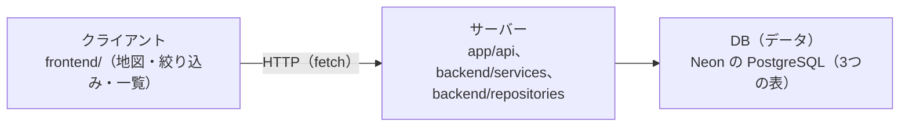

# 静岡市の指定緊急避難場所（学習用・DB版）

静岡市の指定緊急避難場所（402か所）を、地図と一覧で見る小さなアプリです。Next.js 16.4.6 と Neon の PostgreSQL で作っています。データは国土地理院の「指定緊急避難場所データ」です（出典と注意は [data/README.md](./data/README.md)）。

このアプリで学ぶのは、本物のデータに合わせた DB の表の作り方（DB 設計）です。CSV の16の列を、3つの表に分けて持っています。

| 表 | 1行が表すもの | 行の数 |
|---|---|---|
| `shelters` | 避難する場所1か所。主キーは共通ID | 402 |
| `hazards` | 災害の種類（洪水、津波など） | 8 |
| `shelter_hazards` | どの場所が、どの種類に対応しているか（上の2つをつなぐ） | 669 |

表の作り方は [scripts/seed-db.mjs](./scripts/seed-db.mjs)、読み方は [backend/repositories/shelterRepository.ts](./backend/repositories/shelterRepository.ts) にあります。

> サンプルの14件で JSON から DB に替える練習をする版は、タグ `lesson-db` にあります。

## 3つの層



くわしい決まりは [CLAUDE.md](./CLAUDE.md) にあります。Claude Code でこのアプリを広げるときも、このファイルを読んで進めます。

## 動かしてみる

Node.js 20.9 以上が必要です。DB は Vercel から作るので、先に Vercel に公開します。

1. このフォルダを自分の GitHub のリポジトリに送り、Vercel に公開します（Add New → Project → Import Git Repository の一覧から Import → Deploy）。この時点では DB がないので、一覧には「通信に失敗しました（500）」と出ます
2. Vercel のプロジェクトの左のメニューの Storage → Create Database → Neon を選び、DB を作ってこのプロジェクトにつなぎます。Auth はオフ、Connect a Project の画面の Custom Prefix は `DATABASE` にします。環境変数 `DATABASE_URL` が自動で入ります
3. 手元にも `DATABASE_URL` を持ってきます。DB の画面の Quickstart で `.env.local` のタブを選び、Show secret → Copy Snippet を押してから、このフォルダで次を打ちます

```bash
pbpaste > .env.local
```

4. DB に3つの表を作り、`data/shizuoka-city-shelters.csv` の402件を入れます

```bash
npm install
```

```bash
npm run db:seed
```

「shelters の表に 402 件、shelter_hazards の表に 669 件を入れました。」と出れば完了です。DB の画面の Data Editor で、3つの表が見られます。

5. 公開し直します。環境変数は、足したあとの公開から使われるためです。Deployments のいちばん上の行の「…」から Redeploy を押すと、公開先に地図と一覧が出ます

6. 手元で動かします

```bash
npm run dev
```

ブラウザで http://localhost:3000 を開きます。

## APIを見てみる

- http://localhost:3000/api/shelters （全件）
- http://localhost:3000/api/shelters?hazard=tsunami （津波に対応する場所だけ）
- http://localhost:3000/api/shelters?q=清水区 （名前か住所に「清水区」を含む場所）
- http://localhost:3000/api/hazards （災害の種類ごとの件数）

## 練習問題

| 内容 | 難しさ | 触る層 |
|---|---|---|
| Data Editor で、`shelter_hazards` に1行足して、ある場所の対応する種類を増やす | やさしい | DB だけ（コードは触らない） |
| 検索欄を作る（API はもう `?q=` に対応している） | やさしい | フロントだけ |
| 区（葵区・駿河区・清水区）で絞り込む | ふつう | 住所から取り出すか、表に列を足すかを先に決める |
| 地図で、今いる場所から近い順に並べる | ふつう | フロント（並べ替えをどの層に置くかを決める） |
| 指定避難所のデータも取り込み、「同じ住所の避難所」を表示する | むずかしい | 表を足す（DB 設計から） |

進めたあとは、必ず `npm run check` を通します。

## コマンド

| コマンド | 何をするか |
|---|---|
| `npm run dev` | 開発用サーバーを起動 |
| `npm run lint` | コードの決まりを調べる（層の境界も） |
| `npm run check` | lint、型チェック、ビルドをまとめて実行 |
| `npm run db:seed` | `data/shizuoka-city-shelters.csv` から、DB の3つの表を作り直して入れる。DB で直した値は CSV の値に戻る |

## 接続先の扱い

`DATABASE_URL` には、DB の住所と合言葉が入っています。`.env.local` は GitHub に送らない設定にしてあります（`.gitignore` の `.env*`）。人に見せたり、コードに直接書いたりしません。
